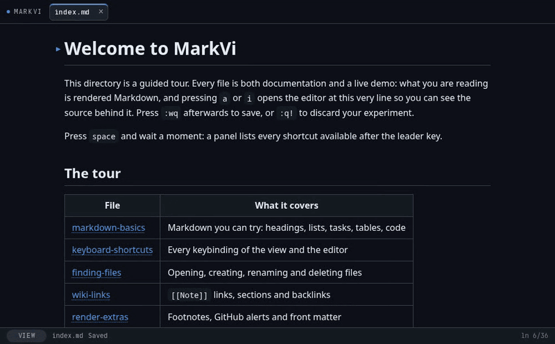

<p align="center"></p>
<p align="center"><em>A local Markdown viewer and editor for your browser with Vim-style keybindings.</em></p>
<p align="center"></p>

## Usage

```
bun install
bun run server.ts ./example        # http://127.0.0.1:3000
bun run server.ts ~/notes -p 4000  # another directory and port
bun run server.ts ~/notes -c my.toml  # another configuration file
```

The app only listens on `127.0.0.1`. The directory is scanned for `.md` files, ignoring hidden files and other irrelevant entries.

## Keybindings

In the rendered view:

| Key                 | Action                           |
| ------------------- | -------------------------------- |
| `j` / `k`           | Next / previous block            |
| `Ctrl-d` / `Ctrl-u` | Half-page down / up              |
| `gg` / `G`          | Beginning / end of document      |
| `]]` / `[[`         | Next / previous heading          |
| `/` / `?`           | Search within the document       |
| `n` / `N`           | Next / previous match            |
| `f`                 | Follow a link using hints        |
| `gt` / `gT`         | Next / previous tab              |
| `{n}gt`             | Go to tab n                      |
| `Ctrl-o` / `Ctrl-i` | Back / forward in history        |
| `x`                 | Toggle the task at the cursor    |
| `Ctrl-^`            | Alternate with the previous file |
| `:`                 | Command (`:e`, `:mv`, `:rm`, `:q`, `:w`) |
| `a` / `i`           | Enter the editor in Normal mode  |
| `space` + `f`       | Search files (create if no match)|
| `space` + `/`       | Search text in all files         |
| `space` + `r`       | Recent files                     |
| `space` + `a`       | Alternate file (same as `Ctrl-^`)|
| `space` + `t`       | Document table of contents (TOC) |
| `space` + `b`       | Backlinks to the current file    |
| `space` + `x`       | Close the active tab             |

Counts work just like in Vim: `5j`, `3]]`, `2gt`, `10G`. The pending key is displayed in the bottom status bar. Pressing `space` and waiting about 300 ms opens a panel showing the available continuations.

## Files

| Command                  | Action                                                                                         |
| ------------------------ | ---------------------------------------------------------------------------------------------- |
| `:e name`                | Open a file. Without `.md` or `/` the name is matched fuzzily, and a new file is created only if nothing matches. With `.md` or `/` the name is exact, so `:e notes/new.md` always creates it when missing |
| `:e #`                   | Alternate file                                                                                 |
| `:mv new-name`           | Rename (or move) the current file; save your changes first                                     |
| `:rm`                    | Delete the current file, after a confirmation. `:rm!` skips it and ignores changes on disk     |

New files get a `.md` extension and are created inside the directory (never outside it, and never hidden). The file finder (`space` + `f`) offers to create the file when there are no matches. `:mv` and `:rm` also work from the editor.

`space` + `/` searches the text of every Markdown file (live, smart-case, literal text) and previews the matching block; `Enter` opens the file at that line. `space` + `r` lists recently opened files, most recent first. `Ctrl-^` and `space` + `a` jump back to the previous one. Many browsers reserve `Ctrl` + digits for their own tab switching and some keyboard layouts need `Shift` for `^`, which is why `space` + `a` exists as well.

## Document Table of Contents

`space` + `t` opens the document heading index, featuring fuzzy search and a section preview. Pressing `Enter` scrolls the view to the selected heading; in the editor, it moves the cursor to that heading's line. It works both in the rendered view and in the editor's Normal mode.

## Wiki Links and Backlinks

`[[Note]]` links to another file by name, without the `.md` extension and ignoring case. The rendered view shows it as a dotted link that opens like any other internal link (`f` follows it with hints too).

| Syntax                | Target                                                            |
| --------------------- | ----------------------------------------------------------------- |
| `[[Note]]`            | The file `Note.md`, anywhere under the directory                  |
| `[[folder/Note]]`     | A path suffix, to tell apart files with the same name             |
| `[[Note#Heading]]`    | A section of that file                                            |
| `[[#Heading]]`        | A section of the current document                                 |
| `[[Note\|text]]`      | Shows `text` instead of the name                                  |

If several files share a name, the one in the same folder as the current file wins, then the least deeply nested one. A path starting with `/` is exact from the root, and `./` and `../` are exact relative to the current file. Links inside code blocks and inline code are left alone, and `\[[` escapes one.

A link to a file that does not exist is shown in red with a dashed underline. Clicking it asks for confirmation and creates the file next to the current one (or at the given path if it has folders). Links update on their own when files are created, renamed or deleted.

`space` + `b` lists the backlinks of the current file: every line of other files that links to it, either with `[[wiki]]` or with a regular relative link such as `[text](../note.md)`. It supports filtering, previews the source file with the line highlighted and `Enter` opens it there. Renaming a file with `:mv` does not rewrite links that point to it.

## Vim Editor

The editor starts in Normal mode. To type, press `a` / `i` again (or `o`, `O`, etc.) once inside the editor, just like in Vim. `Esc` only returns to Normal mode.

`a` / `i` open the editor at the line currently being viewed (or at the selected text, if there is a selection). Double-clicking a block opens the editor at that block's corresponding line. When you exit, the view returns to the block at that line.

Saving is only available through ex commands: `:w`, `:wq`, `:x`, or `ZZ`.

| Command                   | Action                                                                                                |
| ------------------------- | ----------------------------------------------------------------------------------------------------- |
| `:w`                      | Save without exiting                                                                                  |
| `:wq`, `:x`, `ZZ`         | Save and return to the rendered view                                                                  |
| `:q`                      | Return to the rendered view if there are no changes; otherwise, show a warning and stay in the editor |
| `:q!`, `ZQ`               | Discard changes and return to the rendered view                                                       |
| `:set nu` / `:set nonu`   | Absolute line numbers (enabled by default)                                                            |
| `:set rnu` / `:set nornu` | Relative line numbers (disabled by default)                                                           |
| `:set so=N`               | Number of visible lines around the cursor (default: `0`)                                              |

Exiting the editor always returns to the rendered view of the same tab: `:q` never closes a tab. To close a tab, use `space` + `x`.

With line wrapping enabled, `j` / `k` move by screen lines in Normal and Visual modes. When used with an operator (`dj`, `yk`), they operate on logical file lines instead. `gt` / `gT` also switch tabs from Normal mode. The default register is internal to the editor, not the system clipboard.

The browser reserves `Ctrl+W`, `Ctrl+T`, and `Ctrl+N` for its own actions (close tab, open tab, and new window), so these shortcuts cannot be used as they would be in Vim.

## Configuration

MarkVi reads `~/.config/markvi/config.toml` (`$XDG_CONFIG_HOME/markvi/config.toml` if set). Use `--config <file>` or the `MARKVI_CONFIG` variable for another location. A commented example with every option is in [`example/config.toml`](./example/config.toml). Everything is optional, and the file is read on every page load: reload the browser to apply changes. `:config` shows which file is in use.

```toml
leader = ","            # "space" (default) or a single symbol
theme = "dark"          # "auto" (default), "light" or "dark"
font = "JetBrains Mono" # monospace font; Obel Mono is the fallback

[editor]
number = true
relativenumber = true
scrolloff = 5

[keymap.leader]         # keys after the leader
f = "none"              # remove a shortcut
ff = "find"             # sequences of up to 4 keys
n = ":e diary.md"       # an action starting with ":" runs that command
"/" = "grep"            # find, grep, recent, alternate, toc, backlinks, close

[keymap.view]           # rendered view: one key acts as another
J = "j"

[keymap.normal]         # editor mappings, like :nmap / :imap / :vmap
H = "^"

[keymap.insert]
jk = "<Esc>"
```

Invalid values never stop the app: they are ignored, the first problem is shown in the status bar and all of them are printed to the browser console and the server log. A shortcut cannot start with another bound sequence (`ff` while `f` is bound): unbind `f` first. In the editor's Normal mode the leader key replaces its Vim meaning (with `,` you lose "repeat `f` / `t` backwards").

A guided tour of the app lives in the [`example` directory](./example): run `bun run server.ts ./example` and open `index.md`.

## Rendering Extras

Three optional extras, all enabled by default. Disable any of them under `[render]` in `config.toml` (`footnotes`, `alerts`, `frontmatter`) to get the plain rendering back; reload the browser to apply.

| Extra | Syntax | Rendering |
| ----- | ------ | --------- |
| Footnotes | `[^1]` in the text and `[^1]: definition` anywhere | Superscript link to a notes section at the end, with back-references |
| Alerts | `> [!NOTE]` (also `TIP`, `IMPORTANT`, `WARNING`, `CAUTION`) as the first line of a blockquote | Colored callout with its title; the marker line disappears |
| Front matter | `---`, YAML keys, `---` at the very top of the file | Hidden from the view and the TOC; still visible in the editor |

A file that starts with `---` without a closing delimiter keeps rendering it as a horizontal rule.

## Live Reload and Conflicts

The server watches the directory using `fs.watch` and sends notifications over SSE. If a file changes on disk and there are no local edits, the tab reloads automatically. If there is an unsaved draft, the bottom status bar displays a conflict notification with options to reload or overwrite the file.

Saves use `ETag`/`If-Match`: if the file changes between reading and saving, the server responds with `409` instead of overwriting someone else's changes.

Requests that modify files (`POST`, `PUT`, `DELETE`) are rejected when their `Origin` header does not belong to the server, so another website open in your browser cannot create or delete your notes.

## Build as a Command-Line Tool

```
bun run build # generates dist/markvi
install -m 755 dist/markvi ~/.local/bin/markvi
markvi ~/notes # replace notes with your directory
```

The binary bundles the frontend and does not require `bun` to be installed at runtime.

## Licenses

This project is licensed under the MIT License. See the [LICENSE](./LICENSE) file for the full license text.

The interface uses **Obel Mono 1.003** (© 2026 The Obel Mono Project Authors, authored by Cody Collier), self-hosted in `public/fonts/` under the [SIL Open Font License 1.1](public/fonts/OFL,txt). The full license text is available in `public/fonts/OFL.txt`, and the authors are listed in `public/fonts/AUTHORS.txt`.
